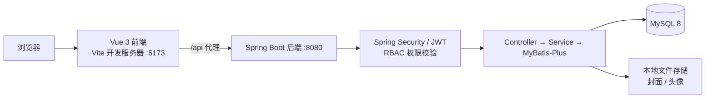
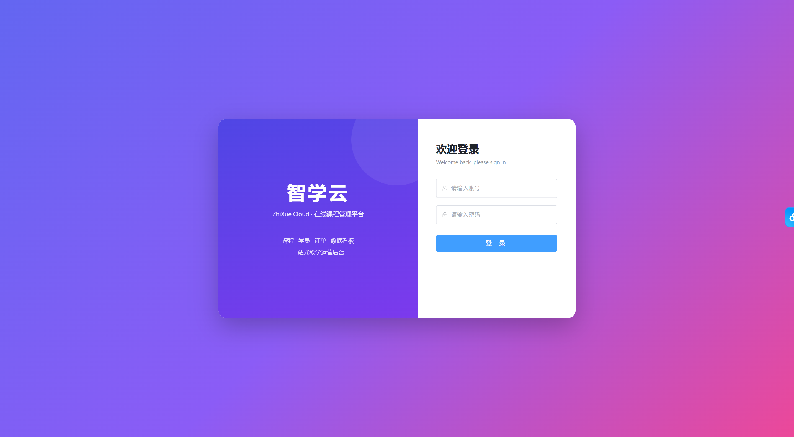
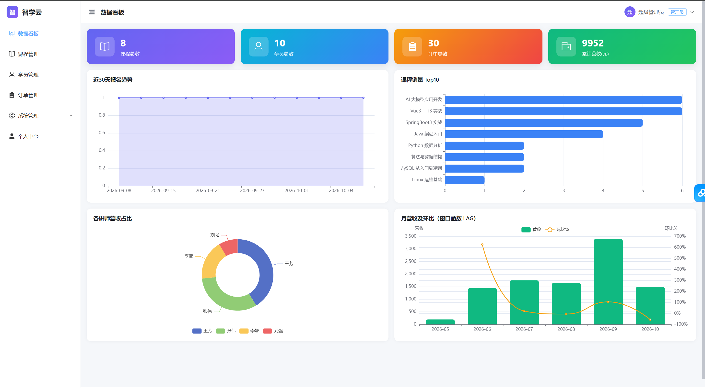
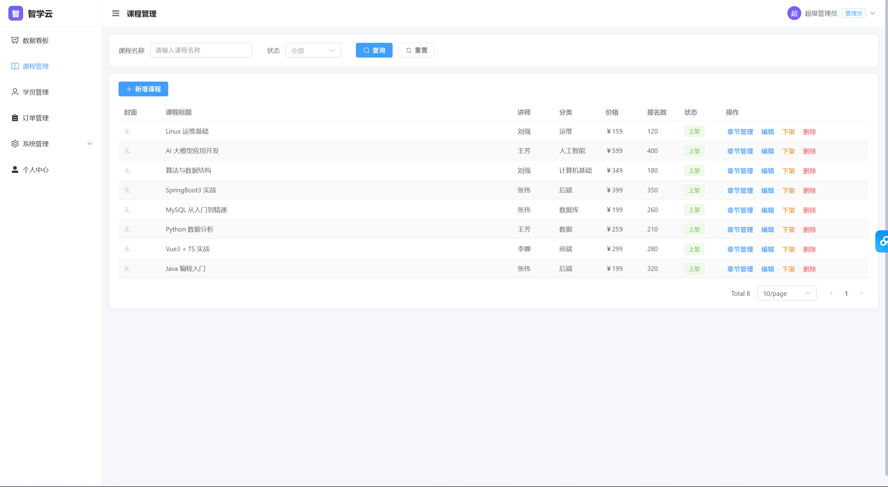
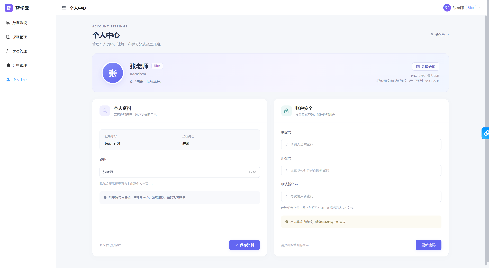

# 智学云 · 在线课程管理平台

为校内培训机构开发的在线课程管理平台，采用 Vue 3 与 Spring Boot 前后端分离架构，面向超级管理员、讲师和学员，支持机构课程运营与学员自主学习。

## 技术栈

- **后端**：JDK 21、Spring Boot 3.4.13、MyBatis-Plus 3.5.9、Spring Security、JWT（jjwt 0.12.6）、MySQL 8、EasyExcel、SpringDoc、Hutool。
- **前端**：Vue 3.5、TypeScript、Vite 6、Element Plus、Pinia、Vue Router、Axios、ECharts。

## 功能亮点

- **权限认证**：用户 → 角色 → 菜单的 RBAC 模型，动态菜单、接口权限校验与 JWT 认证；学员不开放经营数据看板。
- **课程与章节**：课程增删改查、上下架、封面上传、章节管理及文字讲义，内置 8 门课程的示例内容。
- **运营管理**：学员管理、Excel 模板下载与导入导出、订单查询、用户管理。
- **数据看板**：ECharts 展示报名趋势、课程销量 Top10、讲师营收占比及月营收环比，使用 MySQL 8 的 ROW_NUMBER、LAG 窗口函数。
- **学员学习**：支持课程浏览、选课开通、我的课程管理与章节讲义阅读，串联从选课到学习的使用流程；校验已购课程，防止重复购买。
- **个人中心**：昵称编辑、头像上传、密码修改；改密后原有登录令牌失效。

> **交付说明**：本次交付采用模拟支付，支持课程开通及购买记录管理，便于机构验收选课与学习流程；真实支付接口由机构在交付后自行接入。模拟购买记录独立存储，不计入经营看板。

## 项目架构

以下为当前本地运行架构：



## 本地运行

环境：JDK 21、MySQL 8、Node.js 20.19+ 或 22.12+。

### 1. 初始化数据库

在 MySQL 客户端中执行唯一的初始化文件：

```sql
SOURCE /你的项目路径/zhixue-cloud/backend/sql/zhixue.sql;
```

也可在 Navicat 中直接运行 [zhixue.sql](backend/sql/zhixue.sql)。脚本创建 zhixue 数据库、全部业务表、演示账号和课程章节。

**初始化会重建项目表并清空原数据，仅用于首次安装或重置演示库。**

### 2. 启动后端

将 backend/src/main/resources/application.example.yaml 复制为同目录的 application.yaml，修改数据库连接、账号密码和 JWT 密钥，在项目根目录执行：

```powershell
cd backend
$env:ZHIXUE_JAVA_HOME = 'C:\path\to\jdk-21'
.\dev.cmd
```

将 JDK 路径替换为实际路径。也可配置 JAVA_HOME 后运行 Maven Wrapper：Windows 使用 .\mvnw.cmd spring-boot:run，macOS/Linux 使用 ./mvnw spring-boot:run。默认端口为 8080。

### 3. 启动前端

在项目根目录另开终端执行：

```bash
cd frontend
npm ci
npm run dev
```

打开 [http://localhost:5173](http://localhost:5173)；端口被占用时，以终端输出地址为准。

## 演示账号

| 角色 | 账号 | 初始密码 |
| --- | --- | --- |
| 超级管理员 | admin | 123456 |
| 讲师 | teacher01 | 123456 |
| 学员 | student01 | 123456 |

## 在线接口文档

启动后端后访问 [Swagger UI](http://localhost:8080/swagger-ui.html)。需要认证的接口，先登录取得 token，再通过 Authorize 配置 Bearer 认证。

## 功能截图

### 登录页



### 数据看板



### 课程管理



### 个人中心

